## Hello 👋

### GitHub Stats

### 仓库状态

- [txt-sql](https://github.com/CrispyXYZ/txt-sql) - 持续长期开发的 Python 项目，搁置
- [wangran](https://github.com/CrispyXYZ/wangran) - 基于 SSM 的 JavaWeb 后端应用程序，搁置
- [yearn-lang](https://github.com/CrispyXYZ/yearn-lang) - C++ 写的自制语言解释器，搁置
- [GeneticChickengineering-CN-RC30-Extended](https://github.com/CrispyXYZ/GeneticChickengineering-CN-RC30-Extended) - Java 写的 MC Slimefun4 附属插件（汉化并增强版），有限维护

